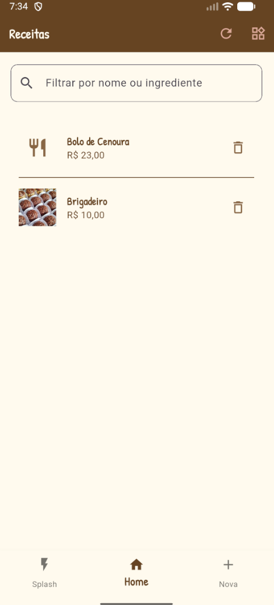
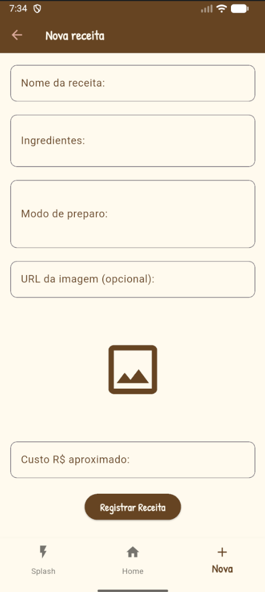
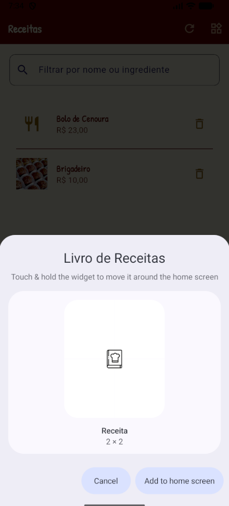
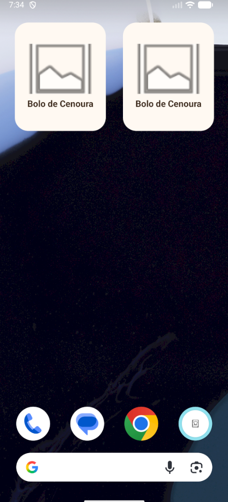

# Livro de Receitas

App Flutter para consultar, buscar, cadastrar, editar e excluir receitas. As informações são salvas em uma API própria publicada na Vercel.

**Backend:** [Backend-Receitas-Flutter](https://github.com/EnzoToniato567/Backend-Receitas-Flutter.git)

## APK

- Para gerar o apk (dentro da pasta `flutter_receitas_api`), basta rodar o comando:

```bash
flutter build apk --release
```

## Funcionalidades

- Lista de receitas com busca por nome ou ingrediente.
- Detalhes com ingredientes, modo de preparo, imagem e custo.
- Cadastro, edição e exclusão de receitas.
- Tema claro e escuro e tela inicial animada.
- Widget Android com nome e foto de uma receita cadastrada.

## Widget na tela inicial do Android

Na lista de receitas, toque no ícone de widget ao lado da receita desejada e confirme a adição à tela inicial. Cada widget mostra a receita escolhida e abre o aplicativo quando é tocado.

Ao atualizar a lista, cadastrar, editar ou excluir uma receita, os widgets existentes atualizam seus dados sem trocar de receita. Se a foto não puder ser carregada, eles mostram uma imagem padrão. É necessário abrir o app com internet para buscar receitas novas da API.

Widgets adicionados antes da escolha individual precisam ser removidos e adicionados novamente.

### Como os arquivos do widget se conectam

1. Em [`lib/ui/home.dart`](flutter_receitas_api/lib/ui/home.dart), cada receita tem um botão para adicioná-la à tela inicial.
2. [`lib/receita_widget.dart`](flutter_receitas_api/lib/receita_widget.dart) salva o nome e a foto da receita e pede ao Android para fixar o widget. A foto é reduzida para caber nele.
3. [`MainActivity.kt`](flutter_receitas_api/android/app/src/main/kotlin/com/example/flutter_receitas_api/MainActivity.kt) envia o pedido de fixação. Quando o usuário confirma, [`ReceitaWidgetPinReceiver.kt`](flutter_receitas_api/android/app/src/main/kotlin/com/example/flutter_receitas_api/ReceitaWidgetPinReceiver.kt) associa o novo widget à receita escolhida.
4. [`ReceitaWidgetProvider.kt`](flutter_receitas_api/android/app/src/main/kotlin/com/example/flutter_receitas_api/ReceitaWidgetProvider.kt) lê essa associação e mostra a receita. Cada widget guarda sua própria escolha.

O [`AndroidManifest.xml`](flutter_receitas_api/android/app/src/main/AndroidManifest.xml) registra os componentes Android. A dependência `home_widget` fica em [`pubspec.yaml`](flutter_receitas_api/pubspec.yaml). Os recursos visuais do widget são:

| Arquivo | Função |
| --- | --- |
| [`res/xml/receita_widget_info.xml`](flutter_receitas_api/android/app/src/main/res/xml/receita_widget_info.xml) | Tamanho e layout inicial do widget. |
| [`res/layout/receita_widget.xml`](flutter_receitas_api/android/app/src/main/res/layout/receita_widget.xml) | Posição da foto e do nome. |
| [`res/drawable/receita_widget_background.xml`](flutter_receitas_api/android/app/src/main/res/drawable/receita_widget_background.xml) | Fundo do card. |
| [`res/values/receita_widget_strings.xml`](flutter_receitas_api/android/app/src/main/res/values/receita_widget_strings.xml) | Nome e textos padrão. |

## Estrutura principal do projeto

```text
Flutter-API-Receitas/
├── README.md
└── flutter_receitas_api/
    ├── pubspec.yaml                 # Dependências e assets
    ├── lib/
    │   ├── main.dart                # Entrada do aplicativo
    │   ├── api.dart                 # Endereço da API de receitas
    │   ├── receita_widget.dart      # Dados e atualização dos widgets
    │   └── ui/
    │       ├── splash.dart          # Tela inicial
    │       ├── home.dart            # Lista de receitas e botão de widget
    │       ├── formulario.dart      # Cadastro e edição
    │       └── style/               # Cores e temas
    ├── android/app/src/main/
    │   ├── AndroidManifest.xml      # Registro dos componentes Android
    │   ├── kotlin/.../              # MainActivity e receivers do widget
    │   └── res/                     # Layout, fundo, textos e configuração
    ├── assets/                      # Ícone, fonte e screenshots
    └── ios/, linux/, macos/, web/, windows/
```

## Como executar

```bash
cd flutter_receitas_api
flutter pub get
flutter run
```

## Screenshots

| Tela inicial | Lista de receitas | Nova receita |
| --- | --- | --- |
|  |  |  |

| Confirmação para adicionar o widget | Widgets na tela inicial do Android |
| --- | --- |
|  |  |
